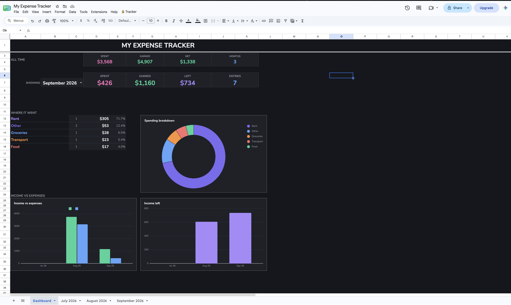
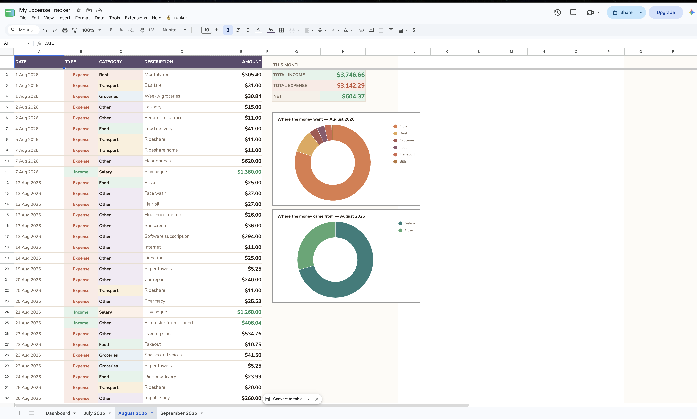

# Back Tap Expense Tracker

Log an expense in about five seconds: double-tap the back of your iPhone, answer four prompts, done. Everything lands in a Google Sheet that builds its own monthly tabs, charts and dashboard.

No app to install, no subscription, no account. iOS Shortcuts on the front, Google Apps Script on the back.



---

## What it does

**On the phone**

Double-tap the back of the device and a prompt chain appears:

```
Amount → Income or Expense → Category → Date → Description
```

Categories change based on what you picked: income offers Salary, E-transfer, Refund, Other; expense offers Food, Transport, Bills, Shopping, Rent, Going-out, Entertainment, Groceries, Other.

The date step defaults to today but can be changed, so an expense you forgot on Tuesday still files under Tuesday — even if that was last month.

**In the sheet**

- A tab per month, created automatically and named `August 2026`
- Entries sorted by date, currency formatted, income green and expense red
- Per-month summary: total income, total expense, net
- Two donut charts per month: where money went, where it came from
- A dark dashboard with a month picker, spending breakdown, income-vs-expense trend and a calendar heatmap of daily spend
- A `💰 Tracker` menu for refreshing and safely deleting entries



---

## Setup

Two halves, roughly 20 minutes total. Full walkthrough in **[docs/SETUP.md](docs/SETUP.md)**, with a compact action reference in **[docs/SHORTCUT.md](docs/SHORTCUT.md)**.

1. **Sheet side** — create a spreadsheet, paste [`src/Code.gs`](src/Code.gs) into Apps Script, deploy as a web app, copy the URL.
2. **Phone side** — build a Shortcut that collects the inputs and sends them to that URL, then bind it to Back Tap.

---

## Architecture

```
iPhone Back Tap
      ↓
iOS Shortcut  ──  collects amount, type, category, date, description
      ↓           builds a GET request
Apps Script Web App (doGet)
      ↓
Google Sheet
      ├── August 2026      entries, summary, donuts
      ├── September 2026   created on the first entry of the month
      ├── Dashboard        picker, KPIs, charts, calendar heatmap
      └── _Data (hidden)   flat table that feeds dashboard formulas
```

The `_Data` sheet exists because dashboard formulas need one consolidated range to query with `SUMIFS`. It is rebuilt on every write.

---

## API

The web app accepts `GET` with these parameters. Short aliases keep the URL short.

| Parameter | Alias | Required | Example |
|---|---|---|---|
| `amount` | `am` | yes | `41` |
| `type` | `ty` | no | `Expense` |
| `category` | `ct` | no | `Groceries` |
| `description` | `ds` | no | `video%20game` |
| `date` | `dt` | no | `2026-08-15` |

```
https://script.google.com/macros/s/YOUR_ID/exec?am=41&ty=Expense&ct=Food&ds=lunch&dt=2026-08-15
```

Omit `dt` and it uses today. Supply it and the entry routes to that month's tab, creating it if needed.

**Utility endpoints**

| Endpoint | Purpose |
|---|---|
| `?repair=1` | Rebuild every tab, chart and the dashboard |
| `?echo=1` | Report the parameters received without writing anything |
| `?debug=1` | Dump the raw parameter object |

---

## Things worth knowing

A handful of Apps Script and Sheets behaviours cost real debugging time to find. They are written up in **[docs/TROUBLESHOOTING.md](docs/TROUBLESHOOTING.md)**, but the short version:

- Google reserves some single-letter query parameters. `c` silently breaks the request before your script runs, which is why the aliases here are two letters.
- Charts cannot read hidden columns, and cannot read a range written in the same execution unless you call `SpreadsheetApp.flush()` first.
- Saving your script does not update the live URL. You must deploy a new version.
- Use the `💰 Tracker → Delete selected entries` menu rather than deleting rows by hand, otherwise the summary formulas that share those rows break.

---

## Customising

**Add a category** — add the menu item in the Shortcut, plus a Text action and a `Set variable Cat` inside that branch. Keep the Text value hyphenated (`Going-out`, not `Going out`).

**Change the look** — the `T` object controls month tabs, `D` controls the dark dashboard. Both are plain colour maps at the top of `Code.gs`.

**Change currency** — edit the `MONEY` and `MONEY0` format strings.

---

## Roadmap

- Per-category monthly budgets with progress bars
- Recurring entries for rent and subscriptions
- Month-over-month comparison in the category list
- Weekly summary notification
- CSV export

---

## Licence

MIT. See [LICENSE](LICENSE).
